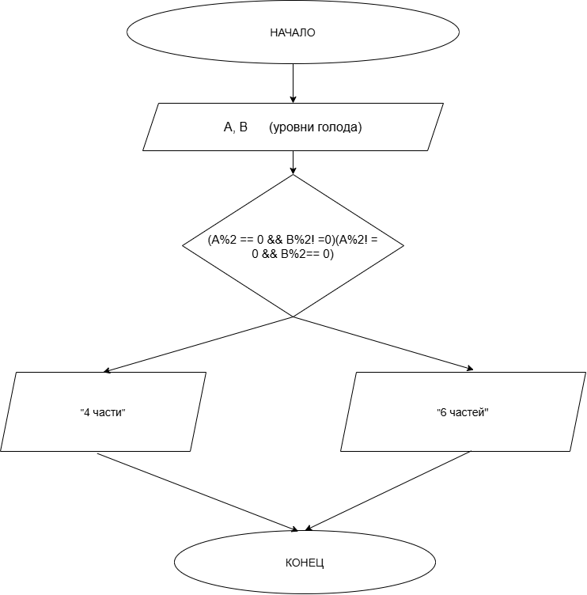

# Домашнее задание к работе 4

## Условие задачи

Друзья заказали пиццу. Они решат разрезать ее на 4 или 6 кусков, по простому правилу: если ровно один из них (Ваня А или Петя В) проголодался (его "уровень голода" — четное число), то разрезать на 4 части. Запишите условие для нарезки на 4 части. *(Задание 3: Дележка пиццы)*

## 1. Алгоритм и блок-схема

### Алгоритм

1. Начало
2. Объявить переменные:
   * `A` — уровень голода Вани (целое число).
   * `B` — уровень голода Пети (целое число).
3. Ввести значения `A` и `B` (например, с клавиатуры).
4. Проверить условие: проголодался ли ровно один из них. Для этого проверяем:
   * Четность `A`: остаток от деления `A` на 2 равен 0.
   * Четность `B`: остаток от деления `B` на 2 равен 0.
   * Условие «ровно один» означает, что одно число четное, а другое — нечетное (или наоборот). В логике это записывается через исключающее ИЛИ (XOR).
5. Вывести результат:
   * Если условие истинно -> `Вывод: "Режем на 4 части"`
   * Иначе (оба четные или оба нечетные) -> `Вывод: "Режем на 6 частей"`
6. Конец

### Блок-схема



## 2.Реализация программы
```text
#include <stdio.h>

int main() {
    int A, B;
    printf("Введите уровень голода Вани (A) и Пети (B): ");
    scanf("%d %d", &A, &B);

    // Проверка: ровно один из них четный
    if ( ((A % 2 == 0) && (B % 2 != 0)) || ((A % 2 != 0) && (B % 2 == 0)) ) {
        printf("Режем на 4 части\n");
    } else {
        printf("Режем на 6 частей\n");
    }

    return 0;
}
```

## 3. Результат  работы программы

Введите уровень голода Вани (A) и Пети (B): 4 3
Режем на 4 части

Введите уровень голода Вани (A) и Пети (B): 2 6
Режем на 6 частей

## 4.Информация о разработчике
Шпагина Арина бИЦТ-262
